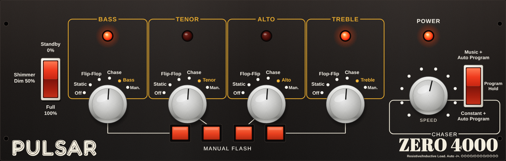

# Pulsar Zero 4000 emulator

A faithful software recreation of the **Pulsar Zero 4000**, the classic four-channel sound-to-light
chaser made by Pulsar Light in the early 1980s. The original front panel appears on your
screen, and it drives modern lighting over your network as **sACN (E1.31)** and/or **DDP**: DMX
dimmers, RGB/RGBW fixtures, and LED strips running WLED and similar controllers.



The behaviour isn't guessed. It is worked out from Pulsar's own circuit diagrams (drawings by RJM,
October–November 1980), stage by stage: the audio filters, the music detectors, the chase circuit, the
auto-program counter and the mains-synchronised output switching. Automatic tests check it against
those drawings.

**[⬇ Download the latest version](https://github.com/ledshed/pulsar_zero4000_emulator/releases/latest)**

---

## Contents
- [What it does](#what-it-does)
- [Download and run](#download-and-run)
- [Quick start](#quick-start)
- [The front panel](#the-front-panel)
- [Connecting your lights](#connecting-your-lights)
- [Menus](#menus)
- [Several units at once](#several-units-at-once)
- [Troubleshooting](#troubleshooting)
- [How faithful is it?](#how-faithful-is-it)
- [Security](#security)
- [For developers](#for-developers)
- [Credits and licence](#credits-and-licence)

---

## What it does
- **Sound-to-light, the 1980 way.** Music is split into four bands (Bass, Tenor, Alto, Treble) with the
  original filter values. Each band flashes its channel when it rises above its own recent level, so there's
  no sensitivity knob to fiddle with, just as on the real unit.
- **Chaser with automatic programs.** It cycles through Pairs, Dark and Light chases, each running forwards
  and then backwards. In *Music* mode the chase steps with the beat; in *Constant* mode it runs at the
  Speed setting.
- **Every front-panel control works:** Standby / Shimmer Dim / Full, the four six-position channel
  selectors, the Manual Flash buttons, Speed, and Music / Program Hold / Constant.
- **Modern outputs:** sACN to any DMX addresses (dimmers, or RGB/RGBW fixtures in any colour order), and
  DDP to pixel strips (WLED, xLights, Falcon…). You pick the colour for each channel.
- **Optional incandescent-lamp simulation**, so LED fixtures fade in and out like the filament bulbs the
  unit was designed for.
- **Several units at once**, each in its own browser tab with its own outputs.
- **Runs anywhere:** Windows 10/11, Windows 7/8, macOS (Apple Silicon and Intel) and Linux. There is
  nothing to install, and it works offline.

## Download and run
Get the file for your computer from the
**[Releases page](https://github.com/ledshed/pulsar_zero4000_emulator/releases/latest)**:

| Your computer | Download | How to start it |
|---|---|---|
| Windows 10 or 11 | `PulsarZero4000-Windows.zip` | Unzip it and double-click **Pulsar Zero 4000.exe**. |
| Windows 7, 8 or 8.1 | `PulsarZero4000-Windows7.zip` | Unzip the **whole folder** and double-click **Pulsar Zero 4000.exe** (keep it next to its `runtime` folder). |
| Mac (macOS 11 or newer) | `PulsarZero4000-Mac.zip` | Drag **Pulsar Zero 4000.app** to Applications and double-click it. |
| Linux (x64) | `PulsarZero4000-Linux.tar.gz` | Unpack it and run `./pulsar-zero4000`. |

Your web browser opens on the front panel. Use Chrome, Edge or Firefox.

- **Windows:** a small black window opens as well. Leave it open while you use the emulator; closing it
  stops the emulator.
- **Mac:** the emulator runs in the background. Stop it with **Unit ▸ Quit** in the browser.

**The first time you run it,** your computer will warn you, because the program isn't signed with a paid
developer certificate:
- **Windows:** "Windows protected your PC". Click **More info**, then **Run anyway**.
- **Mac:** "Apple could not verify…". Open **System Settings → Privacy & Security** and click **Open
  Anyway**.

If the firewall asks, click **Allow**; the emulator needs this to send to your lights. Each download
includes a `READ ME FIRST.txt` with the same steps.

Your settings are saved automatically: in `%APPDATA%\Pulsar Zero 4000` on Windows,
`~/Library/Application Support/Pulsar Zero 4000` on a Mac, and `~/.config/pulsar-zero4000` on Linux.

## Quick start
1. **Start it.** The panel opens in your browser.
2. **Give it sound.** Open **Audio** (under the panel) and choose a source:
   - 🎤 **Mic / line-in:** a microphone, or a mixer plugged into the computer's input;
   - 🖥 **PC audio:** whatever is playing on the computer (Chrome or Edge; tick **Share system audio** in
     the pop-up);
   - 🎵 **Music file:** play a file straight in.
3. **Set the panel.** Put the left rocker on **Full**, the right rocker on **Music + Auto Program**, and
   turn the four channel knobs to **Chase** (or to their music position: Bass, Tenor, Alto, Treble). The
   four red lamps start following the music.
4. **Connect your lights.** Open **Outputs** and tick **sACN** or **DDP** (see
   [Connecting your lights](#connecting-your-lights)).
5. **Optional:** click **⤢ Panel only** (or press **H**) to show just the front panel.

## The front panel
The controls work exactly as the circuit diagrams say. You click or drag the knobs, click the top, middle
or bottom of a rocker, and click (or hold) the Manual Flash buttons. Keys **1–4** also work the Manual
Flash buttons.

**Standby / Shimmer Dim / Full** (left rocker) sets the master output:
- **Standby:** all lights off (0 %).
- **Shimmer Dim:** about 50 %. The original passes every other mains cycle, which gives a gentle shimmer.
- **Full:** 100 %.

**Channel selectors** (one per channel: Bass, Tenor, Alto, Treble):

| Position | What the channel does |
|---|---|
| **Off** | Off. |
| **Static** | On all the time. (On the circuit, this contact is wired straight to the supply rail.) |
| **Flip-Flop / Flop-Flip** | Flashes in step with the chase, Bass + Tenor against Alto + Treble, so the two pairs alternate. |
| **Chase** | Takes its place in the four-channel chase. |
| **Bass / Tenor / Alto / Treble** (amber) | Flashes with its own band of the music. |
| **Man.** | Off, until you hold that channel's **Manual Flash** button. The button only works in this position. |

**Speed** sets how fast the chase runs, from about one step every 3½ seconds up to about 40 steps a
second.

**Music + Auto Program / Program Hold / Constant + Auto Program** (right rocker):
- **Music + Auto Program:** the chase only moves while there's music, and goes faster the busier the music
  is. Speed sets the top rate.
- **Constant + Auto Program:** the chase runs steadily at the Speed setting.
- **Program Hold** (centre): keeps the current chase pattern and direction. It remembers whether you were
  on Music or Constant.

**Auto program:** the chase works through **Pairs** (two lamps on), **Dark** (one lamp off) and **Light**
(one lamp on). Each runs forwards (Bass → Treble → Alto → Tenor) and then backwards (Bass → Tenor → Alto →
Treble). It changes direction every 16 chase cycles and pattern every 32.

**Treble switches off whenever Bass, Tenor and Alto are all on.** This is how the original circuit is
wired. If you'd rather not have it, untick the option under **Emulation**.

The red lamp above each channel shows that channel's output, and **Power** shows the unit is on.

## Connecting your lights
Open **Outputs**.

**Channel colours:** pick a colour for each channel (presets or any colour). Colour fixtures and pixels
show these colours; plain dimmers just use the brightness.

**sACN (E1.31):** for DMX lighting (through an sACN-to-DMX node, or fixtures and software that speak
sACN).
- Choose **multicast** (the usual choice) or a single IP address, and set the **universe**.
- In the **patch**, give each channel the DMX addresses it should drive:
  - **Dimmer addresses**, e.g. `1, 5, 9-12`;
  - **Colour fixtures** by start address, with the fixture's **colour order** (RGB, GRB, RGBW, …). With
    RGBW, white goes to the W channel.
- **Quick patch** fills in a whole row of fixtures for you. They are assigned Bass, Tenor, Alto, Treble,
  Bass, … so the chase runs along the row.

**DDP:** for LED strips and pixel controllers (WLED, xLights, Falcon…).
- Enter the controller's **IP address**.
- Set the **pixels per channel**, **repeat ×N** (to repeat the four channels along a long strip) and the
  colour order.
- Press **Send test**. It lights every pixel white for 5 seconds and **asks the WLED what it's
  receiving**, then tells you in plain words whether it works and, if not, why.

Unticking an output sends black first, so your lights don't freeze on the last frame.

## Menus
- **Unit:** rename this unit, open or add other units, delete a unit, or quit the emulator.
- **Audio:** sound source, input trim and sensitivity, 24-LED meters for the input and each band (with a
  trigger lamp per band), and the band filters (original values, or your own; **Reset to original** puts
  them back).
- **Outputs:** colours, sACN, DDP, frame rate and master level.
- **Emulation:**
  - mains frequency (50 / 60 Hz);
  - lamp simulation (soft incandescent fades, or hard on/off switching);
  - the treble-reset behaviour;
  - the rear-panel remote input (forces Full);
  - power.
- **Monitor:** what's being sent, the chaser's current state, and **Copy diagnostics** (a text report to
  paste into a support message).

## Several units at once
One running emulator can host as many units as you need. Use **Unit ▸ ＋ Add unit**, and each new unit
opens in its own browser tab with its own panel, sound source and outputs. New units start on the next
free sACN universe, and a red **⚠ overlaps another unit** warning appears if two units would drive the
same addresses or pixels.

If you start the program again while it's already running, it just opens another tab. Starting a newer
version automatically closes an older copy, so two copies never fight over your lights.

## Troubleshooting
**No lights at all**
- Is the left rocker on **Full**, and are the knobs off **Off** / **Man.**? The red lamps on the panel
  show what's being sent.
- Is **sACN** or **DDP** ticked in **Outputs**? The status line under each says what's happening.
- **WLED / DDP:** press **Send test** and read the line under it. The common fixes are:
  - in WLED, **Config → Sync Interfaces → Realtime → Receive UDP realtime** must be ticked;
  - check the IP address;
  - firewall or security software may be blocking it.

**Lights don't follow the music**
- Open **Audio** and check the **IN** meter moves.
- With PC audio, make sure **Share system audio** was ticked when you shared the screen.
- If the meters move but nothing triggers, check the knobs are on their music position (or Chase, with
  the right rocker on **Music**).

**Treble never comes on with the other three:** that's the original circuit's treble reset. Untick it in
**Emulation** if you prefer.

**Windows 7:** use the **Windows 7** download. The main Windows version needs Windows 10 or 11 and shows
an error about `GetSystemTimePreciseAsFileTime` on Windows 7.

## How faithful is it?
Each part of the original circuit is modelled. The page numbers refer to Pulsar's circuit diagrams.

| Original circuit | Emulation |
|---|---|
| Audio input and log amp (p3) | Stereo mixed to mono, then diode-style log compression |
| Band filters (p2) | First-order RC filters with the Zero 4000's values: Bass below 106 Hz, Tenor 360–530 Hz, Alto 1.45–2.1 kHz, Treble above 3.6 kHz |
| Music detectors (p7) | Peak detector (≈33 ms attack, 121 ms release) with ≈1 s automatic gain control |
| Run-pulse oscillator (p4) | C9 ramp with the 1 MΩ log Speed pot (≈0.28–42 steps/s). In Music mode the detectors drive it, so the chase only runs with music |
| Music / Hold / Constant (p5) | 4001 latch remembers the mode; Hold stops the program counter |
| Chaser (p6B) | 3 × 4013 shift register; R23 / D8–D9 / D11–D12 / 4016 select the Pairs, Dark and Light feedback; the 4016 reverse switches set the direction |
| Auto program (p6B) | 4024 counter clocked once per chase cycle: ÷2⁵ reverse, ÷2⁶/÷2⁷ pattern, reset after Light |
| Channel selectors (p7) | 2-pole 6-way switch; Static wired to the supply rail; Manual Flash only on *Man.* |
| Output stage (p8B) | 4013 latches clocked by the mains (switching only at zero crossings); Shimmer = alternate cycles; Standby holds the latches off; Treble latch reset by R83 / D15 / D16 when the other three are on; lamps off briefly at power-up (C11) |
| Remote jack | The 4N27 opto input that forces Full: a tick-box under Emulation |

`test/emulator-test.js` checks 22 of these behaviours against the drawings, each naming its page, and it
runs on every build.

**Where the drawings leave room for judgement:**
- exactly how strongly the music speeds up the chase in Music mode (here, two busy bands reach full speed);
- the precise music-trigger threshold.

The **input trim** and **sensitivity** sliders aren't on the original. They help with modern line levels,
and they start neutral.

## Security
The emulator controls real lights, so it is built defensively:
- It only accepts connections from **this computer**.
- Every connection must come from the emulator's own page (Origin and Host checks, which also block
  DNS-rebinding tricks) and carry a **random token** created each time it starts. Other websites open in
  your browser can't control it.
- Incoming messages are size-limited and rate-limited, and malformed ones are rejected.
- Every setting is checked against a strict list of allowed values, ranges and formats.
- Lighting data only goes to **local-network addresses**, unless you tick **Allow internet addresses**.
- Security headers stop the panel being embedded in other sites.

`test/security-test.js` runs 38 attack tests against a running copy.

## For developers
**Run from source** (Node 22 or newer; no runtime dependencies):
```bash
node server.js
```
Options: `--port 8040`, `--data <folder>` (settings folder) and `--no-open` (don't open a browser).

**Tests:**
```bash
npm test
```
This runs the page/script consistency check and the 22 schematic checks. These need a running copy and
[Playwright](https://playwright.dev/):
- `node test/core-test.js beat.wav`: end-to-end, from audio in to sACN/DDP out (use a fresh `--data` folder);
- `node test/security-test.js`;
- `node test/audio-robustness-test.js`.

**Build the downloads:**
```bash
npm install
```
```bash
npm run build
```
This produces Windows, Windows 7, Mac and Linux packages in `dist/`.
- The main packages use Node's *single executable application* support: the app and its page files are
  injected into the official Node binary, with the icon and version information added, and the Mac
  binaries ad-hoc signed.
- The Windows 7 package uses Node 13.14 (the last version that supports Windows 7) and a small C launcher.
  Building it needs mingw-w64.
- The build tools are only needed for building: esbuild, postject and resedit-cli.

**Code layout:**

| File | Purpose |
|---|---|
| `emulator.js` | The circuit model, simulated in 0.5 ms steps. It runs in the server, so the lights keep going when the browser is closed. |
| `public/detector.js` | The audio front end: log amp, band filters, peak detectors, AGC (an AudioWorklet). |
| `public/panel.js` | The SVG front panel. |
| `public/app.js` | The menus and the browser side. |
| `server.js` | Units, saved settings, web server and output loop. |
| `outputs.js` | The sACN and DDP senders. |
| `wsproto.js` | WebSocket protocol, with limits. |
| `validate.js` | Settings validation. |
| `netcheck.js` | Network checks and the WLED status query. |
| `build/` | Build script, icons, launcher and the READ ME FIRST notes. |

## Credits and licence
- Emulation software © 2026 ledshed, released under the **MIT licence** (see [`LICENSE`](LICENSE)).
- Based on the circuit diagrams of the Pulsar Zero 3000 II and Zero 4000 (© Pulsar Light, 1980). This
  project isn't affiliated with or endorsed by Pulsar. "Pulsar" and "Zero 4000" are used only to
  identify the original equipment being emulated.
- The panel fonts are close matches to the original lettering. They are bundled under their own open
  licences (see `public/fonts/LICENSES.txt`):
  - Fredoka for **PULSAR**;
  - Abril Fatface for **ZERO 4000**;
  - Arimo for the legends.
- The packaged downloads include the Node.js runtime (MIT licence).
